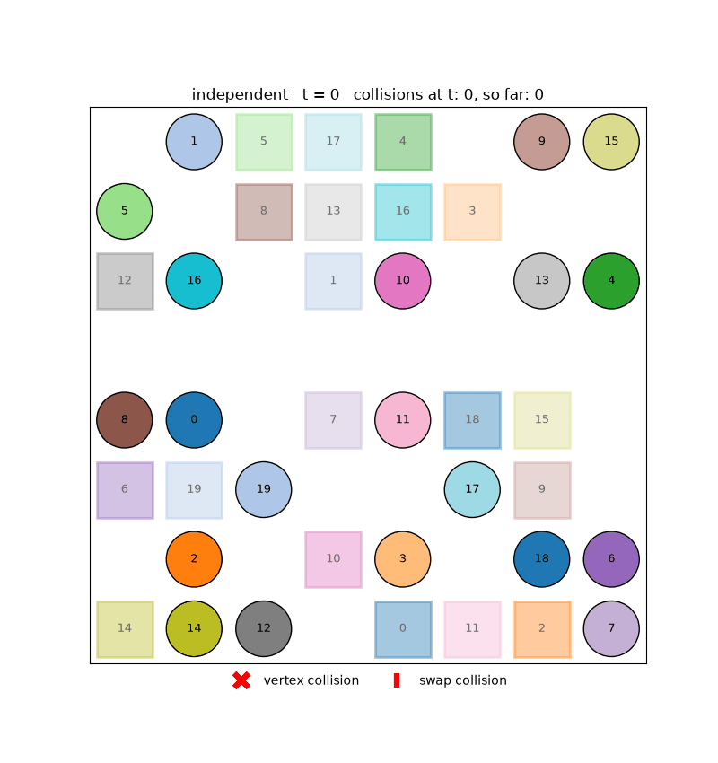
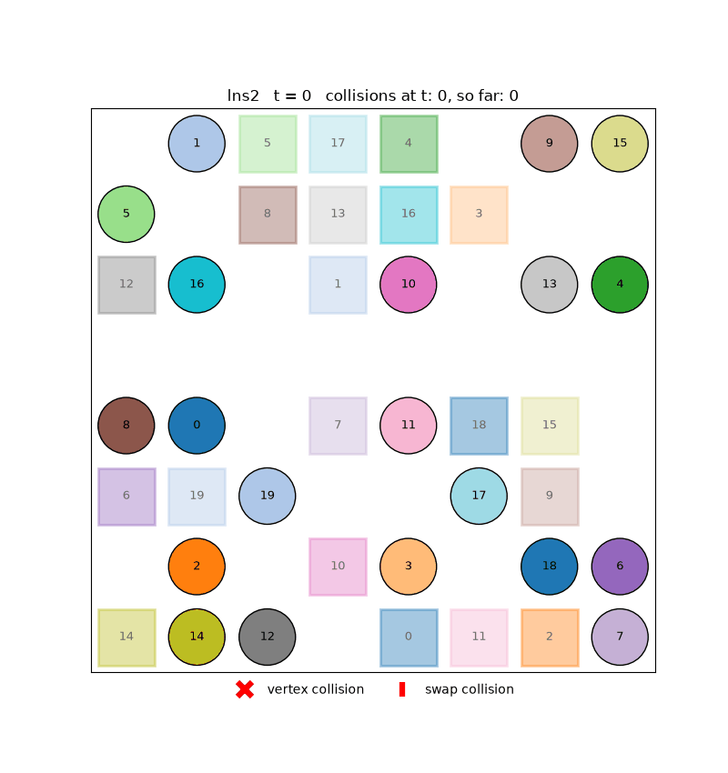
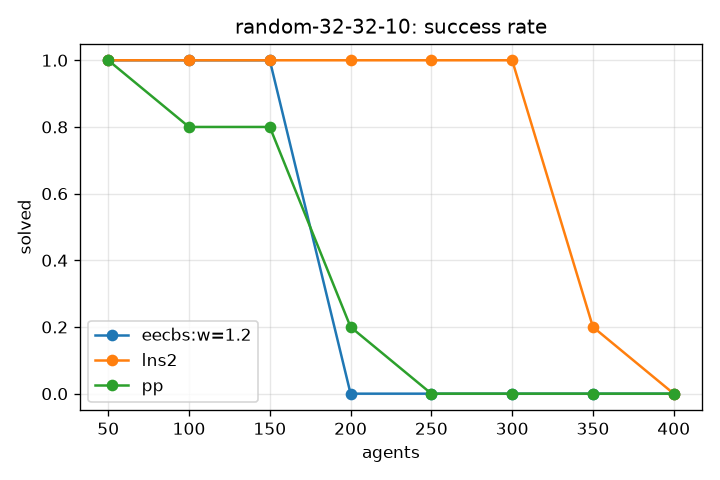
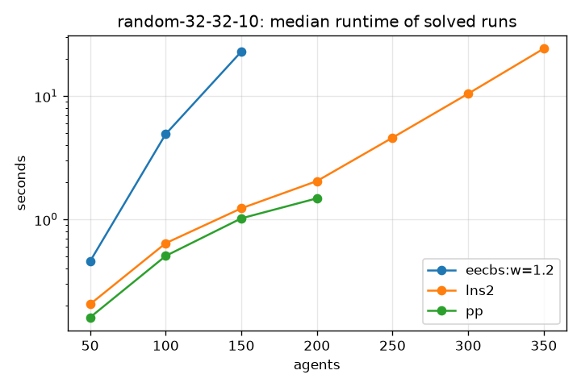

# swarmpath

**A project for learning multi-agent path finding (MAPF) by reading the code.**

The point of swarmpath is its source code. Each algorithm is written to be read next to its
paper:
- plain Python, with `(x, y)` tuples and plain loops;
- no optimizations or caches;
- comments that explain *why* each step is there.

It is not meant to be a fast MAPF library: the C++ implementations from the papers are
50–100× faster. It is meant to make the algorithms easy to understand, step by step.

**The problem:** many agents share a grid. Each has a start and a goal, and all must reach
their goals without colliding. swarmpath implements a state-of-the-art algorithm from two of
the main MAPF families:
- **EECBS**: bounded-suboptimal search;
- **MAPF-LNS2**: repairing a plan with collisions.

It runs on the standard [MovingAI benchmarks](https://movingai.com/benchmarks/mapf.html), and
an independent validator checks every result.

| Every agent planned alone: 13 collisions (red marks) | MAPF-LNS2: collision-free |
|:---:|:---:|
|  |  |

*`empty-8-8`, scenario 1, 20 agents. Circles are agents, squares their goals with the same
number, and lines the paths travelled so far. A red × marks two agents on the same cell, a
red bar two agents swapping across the edge between two cells. Each mark stays from the step
the collision happens until the end, so the last frame shows them all. Prioritized planning
fails on this instance (agent 17 has no path). LNS2 starts from a plan with one colliding
pair and repairs it in 1 iteration.*

## How to learn from this repository

1. **Read the code in dependency order.** Each file is short and builds on the previous ones:

   | step | file | what you learn |
   |---|---|---|
   | 1 | `grid.py`, `instance.py` | maps, scenarios, starts and goals |
   | 2 | `heuristics.py` | exact distances with a backward BFS |
   | 3 | `spacetime.py` | A* over `(cell, t)`, waiting, constraints, other agents as obstacles |
   | 4 | `conflicts.py`, `solution.py` | what a collision is, how a solution is validated |
   | 5 | `solvers/independent.py` | the baseline: everyone ignores everyone |
   | 6 | `solvers/pp.py` | prioritized planning: one agent at a time |
   | 7 | `solvers/eecbs.py` | conflict-based search, focal search, EES, MDDs |
   | 8 | `solvers/lns2.py` | repairing a plan with large neighborhood search |

2. **Follow the history.** The project was built in stages, and each stage is tagged:
   - `git checkout v0`: the shared core and the independent baseline;
   - `git checkout v1`: adds EECBS;
   - `git checkout v2`: adds PP and LNS2.

   `git diff v1 v2` shows exactly what one algorithm needed.
3. **Read the tests as examples.** `tests/maps/` holds tiny hand-made maps with known optimal
   costs: a corridor swap, a 2×2 bottleneck and a dead-end goal. The tests in `tests/` show
   each idea on a few cells. For example, `test_cannot_solve_the_corridor_swap` shows why
   LNS2 is incomplete.
4. **Watch the algorithms run.** Any solve with `--show` animates the result. Try the same
   instance with different solvers, and see where the red marks go.

## What is implemented

| solver | `--algo` | family | guarantee | since |
|---|---|---|---|---|
| Independent | `independent` | baseline | none: ignores other agents; its SOC is a lower bound | `v0` |
| EECBS | `eecbs --w W` | conflict-based search | SOC ≤ W × optimal, optimal at W = 1 | `v1` |
| Prioritized planning | `pp` (`--soft`) | one agent at a time | none: fast but incomplete | `v2` |
| MAPF-LNS2 | `lns2` | large neighborhood search | none: incomplete, repairs collisions | `v2` |

## The MAPF model

- **Grid:** a 4-connected grid from a MovingAI `.map` file.
- **Time and moves:** time is discrete. At each step an agent moves up, down, left or right, or waits. Every step costs 1.
- **Conflicts:** two agents collide when they are on the **same cell at the same time** (vertex conflict) or **swap cells** in one step (edge conflict).
- **Goals:** an agent **stays at its goal** after arriving, and keeps occupying it. An agent that drives over a parked agent collides with it.
- **Cost:** a path costs the time of the agent's *last* arrival at its goal. The objective is the **sum of costs (SOC)**; the makespan is also reported.
- **Heuristic:** exact distances, from a backward BFS from each goal.
- **Validation:** every solution is checked by `solution.validate`. It is written separately from the conflict detection in `conflicts.py`, so a bug in one is caught by the other.

## The algorithms

### Space-time A* — the shared core ([`spacetime.py`](swarmpath/spacetime.py))

Every solver plans single agents in space-time, over states `(cell, t)`. Time is part of the
state because *when* you are somewhere matters, and waiting is a fifth action. Independent,
PP and LNS2 use this A*; EECBS uses a focal-search variant of it (below).

- **Constraints** forbid being on a cell at a time, or making a move at a time. EECBS uses them.
- **Reservation table** (`ConflictTable`): the paths of the other agents, including the agents parked on their goals forever. It works in two modes:
  - **hard**: a move that collides with the table is forbidden;
  - **soft**: collisions are allowed, and the cost is the pair *(collisions, length)*, compared collisions first. The search returns the path with the fewest collisions, and the shortest among those. Copies of a state can then differ in collisions, so states are closed when they leave the open list, not when they enter it.
- **Stopping at the goal is a decision.** An agent that stops on its goal at time t stays there forever, so it also collides with everyone who passes over the goal later. Reaching the goal pushes a separate "done" entry with those collisions added (as SIPPS does), and the search returns when that entry comes out.
- **Termination.** After time T (the last constraint, or the last arrival in the table) nothing changes any more, so a state `(cell, t ≥ T)` is stored as `(cell, T)`. This keeps the search finite. Without it, soft mode would expand every collision-free state up to a time horizon before accepting a single collision.

### Independent ([`solvers/independent.py`](swarmpath/solvers/independent.py))

Each agent takes its shortest path and ignores the others. This is not a MAPF solver. Its SOC
is a **lower bound** on the optimal SOC, and its collisions are what the real solvers must
remove.

### EECBS — Explicit Estimation Conflict-Based Search ([`solvers/eecbs.py`](swarmpath/solvers/eecbs.py))

*Li, Ruml and Koenig, AAAI 2021.* EECBS is bounded-suboptimal: the SOC it returns is at
most `w` times the optimal one.

- **Two levels, as in CBS.** EECBS never searches the joint state space of all agents. The
  **high level** searches a *constraint tree* (CT). Each CT node holds one path per agent:
  1. pick one conflict between two agents;
  2. make two children, each forbidding the conflict to one of the two agents (a vertex `(cell, t)` or a move `(u, v, t)`);
  3. replan only the constrained agent.

  Every collision-free solution respects one of the two branches, so nothing is lost.
- **Low level: focal search.** OPEN is ordered by f and gives `f_min`, a lower bound on the
  agent's path length. FOCAL holds the nodes with `f ≤ w · f_min`, ordered by collisions with
  the other agents' current paths. The low level returns a path at most `w` times the
  shortest that collides as little as possible, together with `f_min` as that agent's lower
  bound.
- **High level: Explicit Estimation Search.** It keeps three views of the same frontier:
  - CLEANUP, ordered by lower bound, which gives LB, a proven bound on the optimum;
  - OPEN, ordered by `f̂`, an online-learned *inadmissible* estimate of the final cost;
  - FOCAL, ordered by number of conflicts, among the nodes with `f̂` within `w` of the best.

  EECBS expands the fewest-conflicts node if its cost ≤ `w · LB`, otherwise the best guess if
  its cost ≤ `w · LB`, otherwise the lowest-bound node, which raises LB. `f̂` is learned with
  *one-step error correction*: ideally, resolving a conflict removes one conflict and adds no
  cost, and the errors measured against that ideal correct the estimate.
- **Conflict prioritization.** An MDD lists, per time step, the cells used by all shortest paths of an agent:
  - width 1 at the conflict means the agent cannot avoid it for free;
  - *cardinal* conflicts, where both agents get more expensive, are split first, because that raises LB fastest;
  - then *semi-cardinal* conflicts, then *non-cardinal* ones.
- **Bypass.** A child that is as cheap as allowed but has fewer conflicts is a better version of its parent, so EECBS adopts the child's path instead of branching.
- **`w = 1`** gives an optimal solver (CBS with prioritization and bypass). The tests check it
  against a brute-force joint-state search on the tiny maps.

### Prioritized planning ([`solvers/pp.py`](swarmpath/solvers/pp.py))

PP plans the agents **one at a time**, in scenario order. Each agent avoids the paths
already in the reservation table (hard mode) or collides with them as little as possible
(soft mode), and then its own path is added to the table.

- **Fast:** N single-agent searches, with no tree.
- **Incomplete:** an agent cannot anticipate the agents planned after it.
  - In `tests/maps/corridor-swap`, agent 0 drives straight to its goal and parks on agent 1's start. The only solution needs agent 0 to *wait* while agent 1 ducks into a side pocket, and hard PP fails.
  - Failures come mostly from **starts and goals**: an agent still at its start, or parked forever on its goal, blocks a later agent's only route.
- **Soft PP never fails because of other agents:** it returns paths that may collide. MAPF-LNS2 is built on it.

### MAPF-LNS2 ([`solvers/lns2.py`](swarmpath/solvers/lns2.py))

*Li, Chen, Harabor, Stuckey and Koenig, AAAI 2022.* MAPF-LNS2 doesn't search for a
collision-free plan. It **repairs** one with *large neighborhood search*:

1. **Start:** plan every agent with soft PP.
2. **Measure:** the objective is the number of edges of the **collision graph**: one node per agent, and an edge between every two agents whose paths collide.
3. **Repair**, until no pair collides or time runs out:
   - choose a *neighborhood* of N = 8 agents;
   - delete their paths;
   - replan them with soft PP, in random order, around the fixed paths of everyone else;
   - keep the new paths if the number of colliding pairs did not increase.

The neighborhood is chosen by one of three heuristics:

- **collision:** the connected component of a colliding agent in the collision graph, so that agents that collide with each other are replanned together.
  - If the component is too big, a random walk on the graph picks N of its agents.
  - If it is too small, the neighborhood is filled with agents met by random walks along cheap alternative routes of its members: the agents *in the way*.
- **failure:** a colliding agent, plus the agents that visit its start and the agents whose goal is on its path. These are the start/goal blockages that make PP fail.
- **random:** random colliding agents.

**Adaptive LNS** picks the heuristic with probability proportional to a weight. The weight is
updated with the colliding pairs that heuristic removed: `w ← γ·removed + (1 − γ)·w`, with
`γ = 0.01`.

Each iteration costs N single-agent searches, however hard the whole problem is, so LNS2
scales to hundreds of agents. It is **incomplete**, inheriting this from PP: it never solves
`corridor-swap`. It also **stops at the first collision-free plan** and makes no attempt to
reduce cost.

## Results

**Setup:** `random-32-32-10` (32×32, 10 % obstacles), the first k agents of MovingAI random
scenarios 1–5, and a 30 s limit per run. EECBS runs with `w = 1.2`. The CSVs are in
[`docs/results/`](docs/results/), and `bench/plot.py` regenerates the plots and tables.
Every solution was checked by the validator.

> **Runtimes are not a performance measure.** The code is written to be learned, not to be
> fast, so it is unoptimized and much slower than the papers' C++ implementations. Look at
> how the algorithms scale and at solution costs, not at seconds.

| success rate | median runtime of solved runs (not a performance measure) |
|:---:|:---:|
|  |  |

**Solved instances** (of 5)

| agents | 50 | 100 | 150 | 200 | 250 | 300 | 350 | 400 |
|---|---|---|---|---|---|---|---|---|
| pp | 5 | 4 | 4 | 1 | 0 | 0 | 0 | 0 |
| eecbs, w = 1.2 | 5 | 5 | 5 | 0 | 0 | 0 | 0 | 0 |
| **lns2** | 5 | 5 | 5 | 5 | 5 | 5 | 1 | 0 |

**Median runtime of solved runs (s)**, for reference only (see the note above)

| agents | 50 | 100 | 150 | 200 | 250 | 300 | 350 |
|---|---|---|---|---|---|---|---|
| pp | 0.2 | 0.5 | 1.0 | 1.5 | – | – | – |
| eecbs, w = 1.2 | 0.5 | 4.9 | 22.9 | – | – | – | – |
| lns2 | 0.2 | 0.6 | 1.2 | 2.0 | 4.6 | 10.5 | 24.3 |

**Solution cost: SOC / independent SOC** (mean over solved runs)

The independent SOC is a lower bound on the optimum, so these ratios are upper bounds on the
real suboptimality.

| agents | 50 | 100 | 150 | 200 | 250 | 300 | 350 |
|---|---|---|---|---|---|---|---|
| pp | 1.083 | 1.152 | 1.225 | 1.270 | – | – | – |
| eecbs, w = 1.2 | 1.013 | 1.031 | 1.066 | – | – | – | – |
| lns2 | 1.083 | 1.144 | 1.219 | 1.280 | 1.346 | 1.427 | 1.517 |

**How hard the instances are:** mean collisions in the independent plan.

| agents | 50 | 100 | 150 | 200 | 250 | 300 | 350 | 400 |
|---|---|---|---|---|---|---|---|---|
| collisions | 54 | 236 | 516 | 948 | 1411 | 2013 | 2743 | 3605 |

**EECBS, varying `w`.** These numbers were measured when EECBS was built (`v1`), on the same
map and scenarios but with a 20 s limit. Success of 5:

| agents | 10–30 | 40 | 50 | 60 | 80–120 | 140 | 160 |
|---|---|---|---|---|---|---|---|
| w = 1 (optimal) | 5 | 4 | 3 | 2 | | | |
| w = 1.1 | 5 | 5 | 5 | 5 | 5 | 0 | 0 |
| w = 1.2 | 5 | 5 | 5 | 5 | 5 | 5 | 0 |
| w = 1.5 | 5 | 5 | 5 | 5 | 5 | 5 | 1 |

On the 24 instances that `w = 1` solved, the real SOC of `w = 1.1`, `1.2` and `1.5` was on
average only 0.3–0.4 % above optimal, and at most 1.2 %. The bound `w` is very loose in
practice.

**Warehouse:** `warehouse-10-20-10-2-1` (161×63, ~5700 free cells), scenarios 1–3, 60 s limit.

| agents | 100 | 200 | 300 | 400 |
|---|---|---|---|---|
| pp | 3/3 | 2/3 | 1/3 | 0/3 |
| lns2 | 3/3 | 3/3 | 1/3 | 1/3 |

The map is large and the paths are long, so here even the *first* soft-PP plan takes
~6 s at 100 agents and ~30 s at 200. From 300 agents on, the unsolved LNS2 runs ran out of
time before a single repair iteration, with 3–7 collisions left.

### What the numbers say

- **EECBS gives the best solutions, but only up to ~150 agents.** Its SOC is within 7 % of
  the lower bound. Where the optimum is known (up to 60 agents, `v1`), it is within ~0.4 %
  of it.
  - At `w = 1` the constraint tree explodes at 40–60 agents. Any slack (`w > 1`) fixes that:
    the tree stays at tens of nodes.
  - Beyond ~150 agents it fails because each CT node is slow in this code (pairwise conflict
    detection, replanning from scratch), not because the tree grows. An optimized
    implementation would go further.
- **PP does the least work, but fails early.** A failure means one agent has no path at all,
  usually because an earlier agent parks on its route or crosses its start. Order matters,
  and PP cannot recover from a bad one.
- **LNS2 scales furthest: 300 agents, 2000 collisions in the independent plan.** Most of
  the work is done by its first soft-PP plan. Up to 200 agents it needs 0–2 repair
  iterations, and at 300 agents 4–13.
- **LNS2's cost is close to PP's, not to EECBS's.** It stops at the first collision-free plan
  and makes no attempt to reduce cost. At 150 agents, where both solve all 5 instances, it is
  ~14 % more expensive than EECBS (1.219 vs 1.066 of the lower bound).
- **At 350–400 agents, the limit is this code, not the method.** One LNS2 iteration then
  takes 2–4 s, so a 30 s run gets only 4–15 iterations, while the C++ implementation runs
  thousands. The unsolved runs ended with 4–11 collisions at 350 agents and 40–63 at 400.


## Quick start

Requires Python ≥ 3.12 and [uv](https://docs.astral.sh/uv/).

```sh
uv sync                     # install matplotlib and pytest into .venv
bash data/fetch.sh          # download the MovingAI maps and random scenarios into data/
uv run pytest               # all tests, a few seconds
```

Solve one instance, print the statistics and validate the result:

```sh
M="--map data/maps/random-32-32-10.map --scen data/scen/random-32-32-10-random-1.scen"
uv run python -m swarmpath solve $M -k 20  --algo independent --show    # watch the collisions (red marks)
uv run python -m swarmpath solve $M -k 100 --algo eecbs --w 1.2
uv run python -m swarmpath solve $M -k 150 --algo pp                    # add --soft to allow collisions
uv run python -m swarmpath solve $M -k 300 --algo lns2 --save lns2.gif
uv run python -m swarmpath solve --map data/maps/empty-8-8.map --random -k 10 --seed 3 --algo eecbs --w 1
```

Benchmark solvers over scenarios and agent counts, then plot the results. An algorithm is
written `name:key=value:...`, for example `eecbs:w=1.2:bypass=0` or `lns2:random=0:adaptive=0`.

```sh
uv run python bench/run.py --map data/maps/random-32-32-10.map \
    --scen data/scen/random-32-32-10-random-{1..5}.scen \
    --algos independent,pp,eecbs:w=1.2,lns2 --agents 50:400:50 --time-limit 30 --out results.csv
uv run python bench/plot.py results.csv --out plots/   # PNGs, plus markdown tables on stdout
```

## Project layout

```
swarmpath/
  grid.py         MovingAI .map loader, 4-connected neighbours
  instance.py     .scen loader, random instances
  heuristics.py   backward BFS distance tables
  spacetime.py    space-time A*: constraints, reservation table, hard and soft modes
  conflicts.py    vertex and swap conflicts between paths
  solution.py     paths, SOC, makespan, Result, the independent validator
  solvers/        independent.py  eecbs.py  pp.py  lns2.py  (one solve() each)
  viz.py          matplotlib animation, collisions marked in red
  cli.py          python -m swarmpath solve ...
bench/            run.py (CSV of solvers × scenarios × agent counts), plot.py
data/             fetch.sh; the downloaded maps and scenarios are git-ignored
docs/             the GIFs, plots and benchmark CSVs used in this README
tests/            unit tests, and tiny hand-made maps with known optimal SOC
```

## Design principles

- **Readable over fast.** Each algorithm is written like its pseudocode:
  - `(x, y)` tuples and plain loops;
  - recomputation instead of caches;
  - pairwise conflict checks.

  The one exception is the time collapse in space-time A*. Soft mode needs it to stay finite, and a comment says why.
- **One interface.** Every solver is `solve(instance, time_limit, **params) -> Result`, so the
  CLI and the benchmark treat them all the same.
- **Always verified.** Every solution goes through the same validator. Every benchmark row records `valid` next to `solved`, and the two always agree.
- **Honest scale.** Python, and code that is deliberately not optimized, are roughly 50–100×
  slower than the C++ implementations from the papers. Runtimes are therefore not a
  performance measure. What the results show is the behaviour of the algorithms: which one
  scales, where each one breaks, and why.

## Limitations and future work

- **No cost improvement after LNS2.** The second phase of MAPF-LNS2 (MAPF-LNS, Li et al. 2021)
  would keep running LNS with SOC as the objective, accepting only cheaper solutions.
- **No SIPPS.** LNS2 uses a soft space-time A* instead of SIPPS, the safe-interval planner
  from the paper. It is much slower when collisions are unavoidable.
- **EECBS lacks newer reasoning.** No CG/WDG heuristics and no rectangle or corridor symmetry reasoning.
- **No separate baselines.** CBS, ICBS and ECBS are not separate solvers; their ideas live inside EECBS.
- **No lifelong MAPF.** RHCR, with windowed planning on a stream of warehouse tasks, is planned
  but not implemented.
- **The failure-based neighborhood is coarse.** It counts agents that visit a start or a goal
  at *any* time, so on crowded maps it often picks agents that do not block anyone.

## References

- R. Stern et al. *Multi-Agent Pathfinding: Definitions, Variants, and Benchmarks.* SoCS 2019.
- G. Sharon, R. Stern, A. Felner, N. Sturtevant. *Conflict-Based Search for Optimal Multi-Agent
  Pathfinding.* Artificial Intelligence, 2015.
- E. Boyarski et al. *ICBS: Improved Conflict-Based Search Algorithm for Multi-Agent
  Pathfinding.* IJCAI 2015.
- J. Li, W. Ruml, S. Koenig. *EECBS: A Bounded-Suboptimal Search for Multi-Agent Path
  Finding.* AAAI 2021.
- J. Thayer, W. Ruml. *Bounded Suboptimal Search: A Direct Approach Using Inadmissible
  Estimates.* IJCAI 2011.
- T. Standley. *Finding Optimal Solutions to Cooperative Pathfinding Problems.* AAAI 2010.
- J. Li, Z. Chen, D. Harabor, P. Stuckey, S. Koenig. *Anytime Multi-Agent Path Finding via
  Large Neighborhood Search.* IJCAI 2021.
- J. Li, Z. Chen, D. Harabor, P. Stuckey, S. Koenig. *MAPF-LNS2: Fast Repairing for Multi-Agent
  Path Finding via Large Neighborhood Search.* AAAI 2022.
- J. Li, A. Tinka, S. Kiesel, J. Durham, T. K. S. Kumar, S. Koenig. *Lifelong Multi-Agent Path
  Finding in Large-Scale Warehouses.* AAAI 2021.
